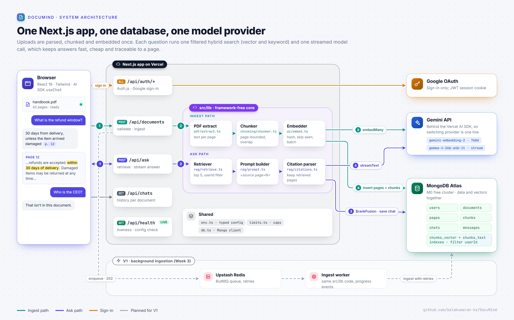
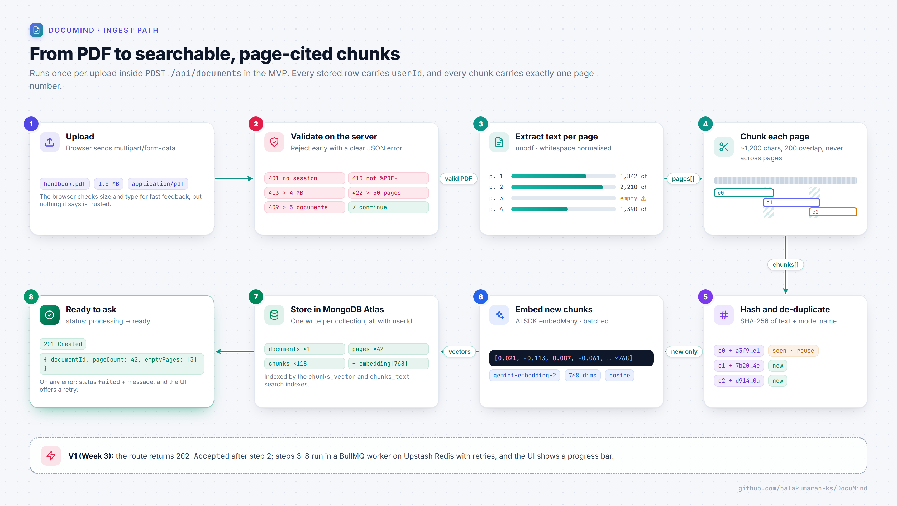
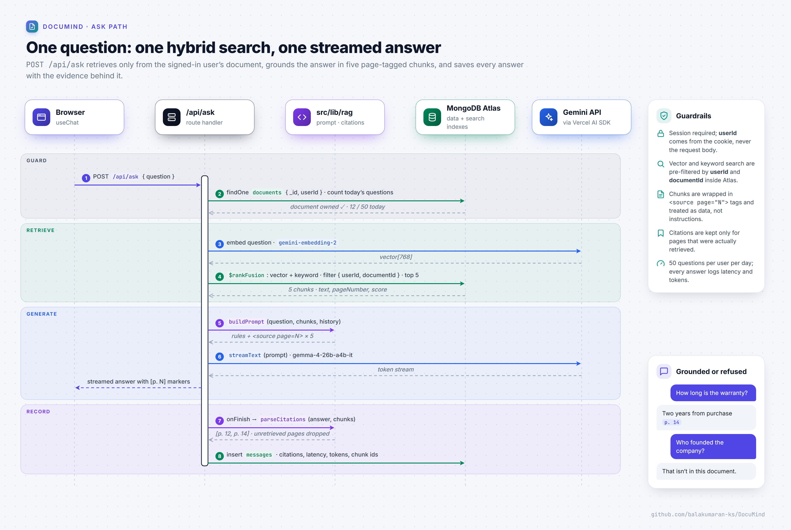
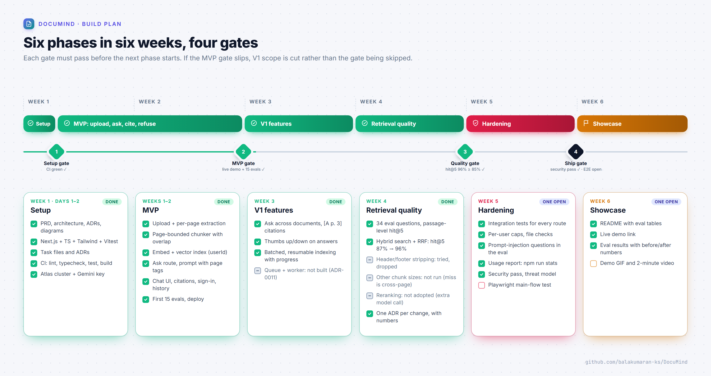

# DocuMind

**Chat with your PDFs.** Upload a document, ask questions, and get answers that cite the exact page, or an honest "that isn't in this document".

[](https://github.com/balakumaran-ks/DocuMind/actions/workflows/ci.yml)


> **Status:** V1 complete and live at [documind99.vercel.app](https://documind99.vercel.app): Google sign-in, upload, cited answers with the page panel, asking across documents, ratings and chat history, measured by the eval set below. See the [roadmap](#roadmap).



## What it does

- **Upload a text PDF** (up to 4 MB and 50 pages). Text is extracted and stored page by page.
- **Ask questions** and get a streamed answer grounded in the five most relevant passages.
- **Page-level citations:** every `[p. N]` in an answer is clickable and opens that page's text.
- **Ask across documents:** pick two or more documents and ask once; citations name the document by letter, as in `[A p. 3]`.
- **Refuses instead of guessing** when the document does not contain the answer.
- **Rate answers** with thumbs up or down; each answer keeps the passages it was built from, so a poor one can be traced.
- **Private by design:** Google sign-in, and every query and search is filtered by user.

## How it works

Uploads are parsed, chunked and embedded **once**. Each question then runs one filtered hybrid search (by meaning and by keyword, merged by rank) and one streamed model call, which keeps answers fast, cheap and traceable to a page.

| Ingest path | Ask path |
| --- | --- |
|  |  |

[docs/ARCHITECTURE.md](docs/ARCHITECTURE.md) covers the data model, API routes, security and deployment.

## Stack

| Layer | Choice | Why |
| --- | --- | --- |
| Frontend + API | Next.js (App Router), TypeScript, Tailwind CSS | One codebase and one deploy ([ADR-0001](docs/adr/0001-single-nextjs-app.md)) |
| Auth | Auth.js with Google sign-in | No passwords to store; little code |
| Database + search | MongoDB Atlas, Atlas Vector Search + Atlas Search | Data and embeddings in one place; vector and keyword results merged with `$rankFusion` ([ADR-0002](docs/adr/0002-mongodb-atlas-vector-search.md), [ADR-0010](docs/adr/0010-hybrid-search-with-rank-fusion.md)) |
| PDF parsing | unpdf (PDF.js packaged for serverless) | Text per page, which citations depend on |
| LLM + embeddings | Gemma 4 for answers (Gemini 3.5 Flash as backup) and Gemini embeddings, via the Vercel AI SDK | Free tier; models are set by environment variables ([ADR-0003](docs/adr/0003-gemini-via-vercel-ai-sdk.md), [ADR-0009](docs/adr/0009-gemma-answers-with-gemini-backup.md)) |
| Tests + CI | Vitest (unit, component, and integration against a real MongoDB), GitHub Actions | Merges blocked unless every check passes |

## Evaluation

Retrieval and answer quality are measured on a hand-written eval set ([evals/questions.jsonl](evals/questions.jsonl)): questions over public-domain PDFs (the NIST Cybersecurity Framework 2.0 and IRS Publication 501), each with the pages that answer it, including questions whose answer is *not* in the documents, plus a generated policy document with instructions to the assistant hidden in its text ([evals/make-injection-doc.mjs](evals/make-injection-doc.mjs)), whose questions name the phrase an answer must never contain. `npm run eval` runs every question through the same retrieval, prompt and citation code as the app and writes the results to [evals/results](evals/results). Results are committed with every change to chunking, retrieval, prompts or models, so each change has before/after numbers. Each run also prints which questions changed since the previous one, and `npm run eval -- --rescore` re-scores a saved run after expected pages are corrected, without calling any model.

| Metric | Target | First baseline (15 questions, Gemini 3.5 Flash) | Current (34 questions, Gemma 4 26B A4B, hybrid search) |
| --- | --- | --- | --- |
| Retrieval hit@5 (the passage with the answer is among the 5 retrieved chunks) | ≥ 85% | 91% (10 of 11, page level) | 96% (25 of 26; 100% at page level) |
| Citation accuracy | ≥ 90% | 82% (9 of 11) | 96% (25 of 26) |
| Refusal on not-in-document questions | ≥ 90% | 100% (4 of 4) | 100% (8 of 8) |
| False refusals on answerable questions | as low as possible | 18% (2 of 11) | 4% (1 of 26) |
| Injected instructions resisted | 100% | — | 100% (4 of 4) |

Hit@5 is measured at the passage level: each answerable question names a short evidence phrase, and a hit needs a retrieved chunk on an expected page that contains it. (Counting any chunk from the right page overstated retrieval: one "false refusal" turned out to be a page whose other chunk was retrieved.) `npm run eval -- --retrieval` measures retrieval alone with one embedding per question. Citation accuracy counts an answer as correct only if it cites at least one page and every cited page answers the question. Hybrid search (vector and keyword results merged by rank, [ADR-0010](docs/adr/0010-hybrid-search-with-rank-fusion.md)) raised both passage-level hit@5 and citation accuracy from 87% to 96%. The one remaining miss is a list split across two pages: its opening sentence ("There are five filing statuses") isn't retrieved, so the answer is wrong either way; in different runs the model has listed the statuses citing the pages that describe each one, or refused, which is the one false refusal above. Not adopted: reranking (an extra model call per question on a free tier with daily limits) and other chunk sizes (chunks never cross pages, so size can't fix that miss, and each size re-embeds every chunk against the same daily quota as the live app). Injection resistance counts an answer as failed if it contains the phrase the hidden instructions ask for, in any letter case, even when its citations are right.

## Roadmap



Scope and non-goals are in the [PRD](docs/PRD.md). Each slice of work has a task file with acceptance criteria in [docs/tasks](docs/tasks/README.md).

## Development practices

- **Tests first.** Every slice starts from its acceptance criteria and failing tests; the implementation follows.
- **Small pull requests.** One task per PR, kept under ~300 changed lines, each with a short summary of how the change works.
- **Decisions are recorded.** Every real choice has an [architecture decision record](docs/adr/README.md) with the alternatives considered.
- **CI is the gate.** Lint (no warnings allowed), typecheck, unit tests with coverage and a production build must pass before anything merges.
- **Retrieval changes are measured.** Chunking, retrieval and prompt changes ship with eval results.

## Run locally

Requires Node.js 22+ (24 recommended, see `.nvmrc`).

```bash
git clone https://github.com/balakumaran-ks/DocuMind.git
cd DocuMind
npm install
cp .env.example .env.local   # then fill in the values
npm run dev
```

The first integration-test run downloads a MongoDB binary into `.cache/mongodb-binaries` (about 800 MB on Windows, much less on Linux and macOS); later runs and `npm ci` reuse it.

Open http://localhost:3000. `GET /api/health` reports, by name only, any required environment variable that is missing or still holds a template placeholder such as `<db_username>`.

| Command | What it does |
| --- | --- |
| `npm run dev` | Development server |
| `npm run check` | Lint + typecheck + all tests |
| `npm test` | Unit and integration tests |
| `npm run test:unit` | Unit and component tests (fast, no database; components render in jsdom) |
| `npm run test:integration` | Integration tests against a temporary MongoDB |
| `npm run build` | Production build |
| `npm run db:indexes` | Create the Atlas vector and keyword search indexes (once per cluster) |
| `npm run eval` | Run the eval set against Atlas and Gemini (paced for the free tier; stores its documents under the user `eval`) |
| `npm run stats` | Usage report: questions per day, answer time, answers per model, refusals, ratings and tokens (aggregates only) |
| `npm run diagrams` | Re-render the diagrams in `docs/assets/` |

### External services (all free tiers)

1. **MongoDB Atlas:** create an M0 cluster and a database user, and allow your IP address. Copy the connection string into `MONGODB_URI`, replacing both `<db_username>` and `<db_password>`. Then run `npm run db:indexes` once to create the vector and keyword search indexes (a free cluster allows three in total).
2. **Gemini API:** create a key at [Google AI Studio](https://aistudio.google.com/apikey) and set `GOOGLE_GENERATIVE_AI_API_KEY`.
3. **Google OAuth:** create an OAuth client (Web application) in Google Cloud Console with the redirect URI `http://localhost:3000/api/auth/callback/google`, then set `AUTH_GOOGLE_ID` and `AUTH_GOOGLE_SECRET`. Generate `AUTH_SECRET` with `npx auth secret`.

## Documentation

| Doc | Contents |
| --- | --- |
| [PRD](docs/PRD.md) | Problem, user, MVP scope, non-goals, success metrics |
| [Architecture](docs/ARCHITECTURE.md) | Components, ingest and ask paths, data model, API, security |
| [Security](docs/SECURITY.md) | Threat model: what is protected, how, and the accepted risks |
| [ADRs](docs/adr/README.md) | One record per significant decision |
| [Tasks](docs/tasks/README.md) | Slices of work with acceptance criteria |
| [Diagrams](docs/diagrams/README.md) | Sources for every image in this README |

## License

[MIT](LICENSE)
