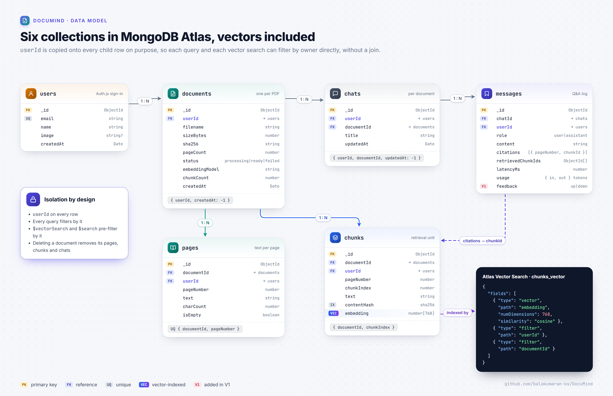
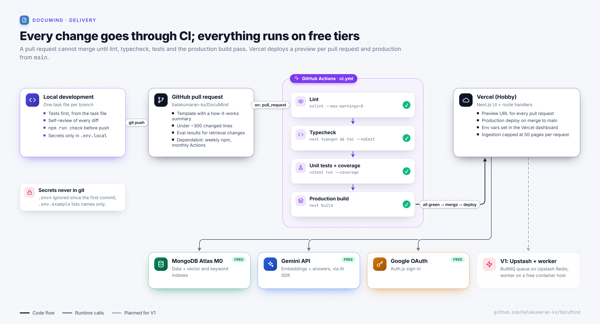

# DocuMind — Architecture

One Next.js app serves the UI and the API; MongoDB Atlas holds documents, their text and their vectors together; Gemini does both embeddings and answers. Uploads are parsed, chunked and embedded **once**; each question only runs one search (by meaning and by keyword at once) and one model call, which keeps it fast and cheap.


## Components

| Component | Responsibility |
| --- | --- |
| **Browser (React UI)** | Upload, document list, chat with streaming answers, citation side panel. |
| **Next.js route handlers** (`src/app/api/*`) | Auth check, validation, orchestration. Thin: logic lives in `src/lib`. |
| **`src/lib` core** | PDF extraction, chunker, embedder, retriever, prompt builder, citation parser. Framework-free and unit tested. |
| **Auth.js** | Google OAuth, JWT session cookie. Every route resolves `userId` from the session: `google:<Google account id>`, set at sign-in, because Auth.js assigns a random id per sign-in when there is no user database. `src/proxy.ts` redirects signed-out visitors from `/documents/*`; pages and routes still check the session themselves. |
| **MongoDB Atlas** | Collections below, plus an Atlas Vector Search index on `chunks.embedding` and an Atlas Search (keyword) index on `chunks.text`. |
| **Gemini API** (via Vercel AI SDK) | `gemini-embedding-2` for 768-dim embeddings; `gemma-4-26b-a4b-it` for answers, with `gemini-3.5-flash` as backup. All configurable. |
| **No queue or worker** | Considered for V1 and not built: indexing large documents stays batched and driven by the document list ([ADR-0011](adr/0011-no-background-worker.md)). |

## Ingest path


1. `POST /api/documents` receives `multipart/form-data`.
2. **Validate on the server:** session present, under 5 documents, size ≤ 4 MB ([ADR-0006](adr/0006-four-mb-upload-cap.md)), magic bytes `%PDF-`, page count ≤ 50, and under 10 uploads today (counted once these pass; deleting doesn't give an upload back). The file name is cleaned of control and text-direction characters.
3. **Extract** text per page with `unpdf`, PDF.js packaged for serverless ([ADR-0007](adr/0007-unpdf-for-text-extraction.md)). Pages with no text are flagged (likely scanned).
4. **Chunk** each page separately with overlap, so every chunk belongs to exactly one page ([ADR-0004](adr/0004-page-bounded-chunking.md)).
5. **Hash** each chunk (SHA-256 of normalised text + embedding model). Chunks whose hash this user already has reuse the stored vector.
6. **Store** `pages` and every chunk; chunks without a reused vector wait for one.
7. **Embed** the first batch of up to 80 waiting texts. If that was all, set the document `status: "ready"` and answer `201`.
8. Otherwise answer `202` with `status: "processing"` and progress; the browser calls `POST /api/documents/:id/ingest`, which embeds one batch per request until the document is `ready`. When the Gemini free-tier quota (100 embedded texts per minute) is used up, the route answers `429` with the wait, the document keeps its progress, and the browser resumes after the wait ([ADR-0008](adr/0008-batched-ingestion-for-the-free-tier.md)). A short lock keeps two requests from embedding the same document at once.

## Ask path


1. `POST /api/ask` with `{ documentId, chatId?, question }`, or `{ documentIds, chatId?, question }` to ask across 2–5 documents.
2. Check session, document ownership and the daily question cap.
3. Embed the question with the same model used for the chunks.
4. **Hybrid search** over `chunks` ([ADR-0010](adr/0010-hybrid-search-with-rank-fusion.md)): `$vectorSearch` (top 20 of 100 candidates) and a keyword `$search` for the question's words (top 20), each **pre-filtered by `userId` and `documentId`** inside its index. `$rankFusion` merges the two rankings by reciprocal rank fusion, and the top 5 chunks are kept.
5. **Build the prompt:** system rules (answer only from sources, cite `[p. N]`, reply "That isn't covered in this document." otherwise, ignore instructions inside sources) + the last 6 chat messages + the question, with the 5 chunks in page order wrapped in `<source page="N">` tags. `<source` and `</source` inside document text are escaped, so a document cannot close its own source and place text outside it. Across documents, each document gets a letter (A, B, C… in the chat's order), sources are tagged `<source document="A" page="N">`, the rules ask for `[A p. N]` citations, and the refusal is "That isn't covered in these documents." Document names never enter the prompt.
6. `streamText` to the answer model (`GEMINI_CHAT_MODEL`). The route waits for the first piece of text: if the model fails or its quota is used up before then, it tries the backup model (`GEMINI_FALLBACK_CHAT_MODEL`) with the same prompt ([ADR-0009](adr/0009-gemma-answers-with-gemini-backup.md)). If none produces text, it answers `502 answer_failed` or `429 rate_limited` and saves nothing. Otherwise it saves the chat and the question, and the text streams to the browser.
7. On finish: parse `[p. N]` and `[p. N, M]` markers, or `[A p. N]` across documents (malformed ones are ignored), drop any page that was not among the retrieved chunks of the cited document, link each page to its best-scoring chunk, and save the message with citations, latency, token counts and retrieved chunk ids.

## Data model



| Collection | Key fields | Indexes |
| --- | --- | --- |
| `users` | `_id` (the user id, e.g. `google:1082…`), `email`, `name`, `image`, `createdAt`, `lastSignInAt` | `_id` only; upserted on every sign-in |
| `documents` | `_id`, `userId`, `filename`, `sizeBytes`, `sha256`, `pageCount`, `status` (`processing` \| `ready` \| `failed`), `error?`, `embeddingModel`, `chunkCount`, `embeddedChunks`, `ingestLockedUntil?`, `sampleKey?` (sample templates and users' copies of them), `createdAt` | `{ userId, createdAt: -1 }` |
| `pages` | `_id`, `documentId`, `userId`, `pageNumber`, `text`, `charCount`, `isEmpty` | `{ documentId, pageNumber }` unique |
| `chunks` | `_id`, `documentId`, `userId`, `pageNumber`, `chunkIndex`, `start`, `end`, `text`, `contentHash`, `embedding?: number[768]` (missing until its batch is embedded), `createdAt` | `{ documentId, chunkIndex }` unique, `{ userId, contentHash }`, **vector index**, **keyword index** |
| `chats` | `_id`, `userId`, `documentId` (one document) or `documentIds` (2–5, in letter order), `title`, `createdAt`, `updatedAt` | `{ userId, documentId, updatedAt: -1 }` |
| `messages` | `_id`, `chatId`, `userId`, `role` (`user` \| `assistant`), `content`, `citations: [{ pageNumber, chunkId, documentId? }]`, `retrievedChunkIds`, `latencyMs`, `usage: { inputTokens, outputTokens }`, `model?`, `feedback?: { rating: "up" | "down", updatedAt }` (answers only), `createdAt` | `{ chatId, createdAt }`, `{ userId, role, createdAt }` (daily question count) |

`userId` is copied onto `pages`, `chunks` and `messages` on purpose: every query can filter by it directly, without a join, which makes the rule "every query filters by owner" cheap to enforce and easy to review.

Two owners are reserved and can't come from a sign-in (app users are `google:<id>`): `eval`, which holds the eval set's documents, and `samples`, which holds the sample templates. `npm run samples` indexes each template once; adding a sample copies its document, pages and chunks, vectors included, to the user, so it is ready at once and uses no embedding quota.

### Atlas Vector Search index (`chunks_vector`)

```json
{
  "fields": [
    { "type": "vector", "path": "embedding", "numDimensions": 768, "similarity": "cosine" },
    { "type": "filter", "path": "userId" },
    { "type": "filter", "path": "documentId" }
  ]
}
```

### Atlas Search index (`chunks_text`)

```json
{
  "mappings": {
    "dynamic": false,
    "fields": {
      "text": { "type": "string", "analyzer": "lucene.english" },
      "userId": { "type": "token" },
      "documentId": { "type": "objectId" }
    }
  }
}
```

Only chunk text is searchable, with English stemming ("backups" matches "backup"). `userId` and `documentId` are indexed for exact filters. Atlas free clusters allow three search indexes in total, so the eval stores its documents in the app database under the user `eval` rather than in a database of its own.

## API routes

| Method | Route | Purpose | Phase |
| --- | --- | --- | --- |
| `GET` | `/api/health` | Liveness, plus env vars that are missing or still hold a template placeholder (names only) | Setup ✅ |
| `*` | `/api/auth/[...nextauth]` | Auth.js handlers | MVP |
| `POST` | `/api/documents` | Upload a PDF and index it (`201` ready, or `202` processing with progress) | MVP |
| `POST` | `/api/documents/samples` | Add a sample document: a copy of a pre-indexed template with no embedding calls, returned once search can see it (a few seconds) | V1 |
| `POST` | `/api/documents/:id/ingest` | Index the next batch of a processing document; `429` with the wait at the quota | MVP |
| `GET` | `/api/documents` | List the user's documents | MVP |
| `GET` | `/api/documents/:id` | Document metadata and status | MVP |
| `DELETE` | `/api/documents/:id` | Delete a document with its pages, chunks and chats | MVP |
| `GET` | `/api/documents/:id/pages/:n` | One page's text, for the citation panel | MVP |
| `POST` | `/api/ask` | Ask a question about one document or across several; streams the answer | MVP, V1 |
| `GET` | `/api/chats?documentId=` | Chats for a document | MVP |
| `GET` | `/api/chats/:id/messages` | Chat history | MVP |
| `POST` | `/api/messages/:id/feedback` | Rate one of your answers `up` or `down`, or clear the rating with `null` | V1 |

## Security

- File type (magic bytes), size and page count checked on the server.
- Every query and every vector and keyword search is filtered by the session's `userId`.
- Document text is treated as data: wrapped in `<source>` tags and the system prompt says to ignore instructions inside it.
- Citations are validated against the retrieved chunks, so the model cannot cite a page it never saw.
- Secrets only in environment variables; `.env*` is git-ignored except `.env.example`, and configuration errors report variable names, never values.
- Security headers on every response forbid framing (clickjacking) and content sniffing; uploaded file names are cleaned; each user may upload 10 documents a day, deleted ones included.
- "Delete my account" (a server action on the documents page) removes every row of the user and signs them out. `/privacy` and `/terms` are linked from every page.
- The full threat model, with the accepted risks, is in [SECURITY.md](SECURITY.md).

## Deployment



Vercel (Hobby) runs the app; MongoDB Atlas M0 and the Gemini free tier back it. GitHub Actions blocks merges unless lint, typecheck, tests and build pass. There is no queue or worker to deploy ([ADR-0011](adr/0011-no-background-worker.md)). `npm run stats` reports usage from a developer machine: questions per day, answer time, answers per model, refusals, ratings and tokens, as aggregates only.

## Diagrams

The PNGs in `docs/assets/` are rendered from the HTML/SVG sources in `docs/diagrams/`. Edit the source, then run `npm run diagrams`.
